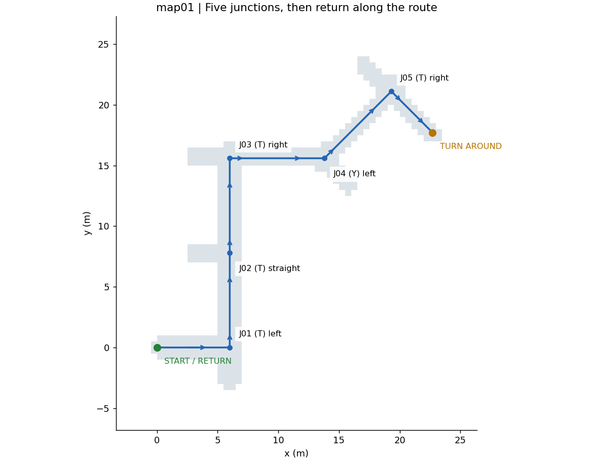

# 巡渊 S10 参赛队伍自评

用自己的模型完成两项任务：在 MuJoCo 中控制 S10 轮足机器人往返巡检，以及从巡检视频中读出数字牌和温度。两项可单独运行。仓库包含五张地图、八段练习视频和对应答案。

| 自评项目 | 分值 | 成绩如何组成 |
|---|---:|---|
| [导航与运动控制](#navigation) | 50 | 路线 30 分、侧推 10 分、地面摩擦 10 分 |
| [视频识别](#recognition) | 20 | 按正确识别的标牌比例计分 |

**安装**　以下命令在仓库根目录执行，使用 Python 3.11。在 Linux 无显示器环境使用前置相机时，先设置 `export MUJOCO_GL=egl`。macOS 使用默认图形后端。

```bash
python3.11 -m venv .venv
source .venv/bin/activate
python -m pip install -e ".[runtime]"
```

首次接入可以生成项目模板。把模板里的推理代码和权重换成自己的实现，保持 `submission.json` 中的队伍名称一致。模板导航输出零动作，识别输出空列表，适合先检查接口。每次运行使用新的结果目录。

<a id="navigation"></a>

## 导航与运动控制 · 50 分

每张地图有五个路口。机器人按给定的方向序列到达折返点，再按返程指令回到起点。例如一号图去程依次为左、直、右、左、右。



[查看全部五张地图与路线指令](challenge/README.md)

导航项目接收前置 RGB 图像、雷达点云或两者，以及路线指令、IMU 和关节状态。每次输出 16 个动作值，分别控制 12 个腿部关节和 4 个轮子。先生成仅含导航项目的模板，在一号图上运行短时检查。

```bash
python -m tools.make_project_example --task navigation --output artifacts/nav_team
python -m xunyuan_eval navigation --submission artifacts/nav_team/submission.json \
  --route map01 --max-seconds 3 --output results/nav_trial
```

换上自己的策略后，运行五张地图的完整自评。每张地图测试一次正常路线、四档侧推和四档地面摩擦，共 45 次。单图或限时试跑的报告会标为 `complete: false`。

```bash
python -m xunyuan_eval navigation --submission artifacts/nav_team/submission.json \
  --output results/navigation
```

打开 `results/navigation/report.json` 看三个分项。排查失分时，找到对应地图和测试条件：

| 在报告中查看 | 怎样理解 |
|---|---|
| `details.routes` | 查看每段的 `reached` 和 `maximum_deviation_m`。例如一段已完成、最大偏离 0.22 米，在正常结束时该段得 0.75 分。 |
| `details.disturbance` | 按地图和 `force_N` 查侧推结果。每档独立计分，完整经历三次侧推并通过该路线可得 0.5 分。 |
| `details.friction` | 按地图和 `friction` 查对应地面条件。若 `reason` 为 `fall`，可在该次运行的 `states.json` 中查看倾倒前的姿态。 |

[详细评分规则](docs/rules.md) · [传感器与动作接口](docs/model-interface.md)

<a id="recognition"></a>

## 视频识别 · 20 分

八段练习视频每段十分钟，包含六个数字牌和六个温度屏，共 96 个标牌。识别项目按每秒五帧接收 RGB 图像，返回标牌框、可信度和读数。普通数字保留前导零、符号和小数点，温度单位为 `C`，允许 0.1 ℃ 误差。完全无法辨认的标牌可输出 `abstain` 并注明原因。

先在一段视频上调试。这个项目只需要识别代码和权重。

```bash
python -m tools.make_project_example --task recognition --output artifacts/ocr_team
python -m xunyuan_eval recognition --submission artifacts/ocr_team/submission.json \
  --video train01 --output results/ocr_trial
```

换上自己的识别模型后，运行全部八段视频。

```bash
python -m xunyuan_eval recognition --submission artifacts/ocr_team/submission.json \
  --output results/recognition
```

在 `report.json` 的 `scores.recognition` 中查看答对数、总数和逐牌结果。例如，`train01/E01` 在约 15.6 至 23.6 秒出现，读数是 `-73499`。若该项为 `missing`，对照训练答案中的标牌框和 `video_predictions.json` 中的时间、位置及置信度；若为 `incorrect`，直接对比 `prediction` 和 `expected_value`。完整识别分为 **20 × 答对数 / 96**。

[练习视频与答案](datasets/videos/) · [可选 OCR 图片集](docs/image-datasets.md)

## 合并成绩与打包

两份单项报告均完成后，直接合并为 70 分制自评成绩。两份清单中的 `team` 需一致。

```bash
python -m xunyuan_eval combine --navigation results/navigation/report.json \
  --recognition results/recognition/report.json --output results/combined.json
```

若已把两项模型放在同一份提交清单中，可用 `run-submission` 一次运行两项。提交时再加上评委评分的 PDF 报告（30 分），将代码、权重、依赖说明和报告打包。

```bash
python -m xunyuan_eval run-submission --submission my_team/submission.json --output results/team
python -m xunyuan_eval package-models --submission my_team/submission.json --output artifacts/team.zip
```

[提交清单与目录示例](docs/submission.md)
