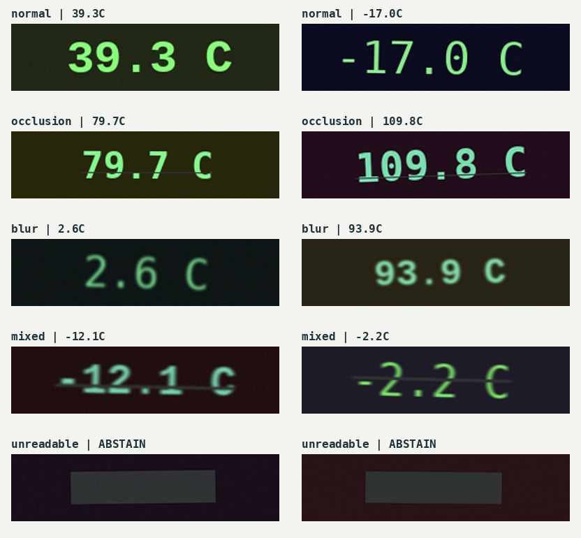

# 温度屏图片

这组静态图片供开发和验证温度识别模型使用，共 15,000 条合成样本。每条样本包含一张面板图、一张数字裁剪图和对应读数。温度范围为 −20.0 至 120.0 ℃，保留一位小数。图片包含清晰、遮挡、模糊、遮挡加模糊和无法辨认五种情况。

| 用途 | 样本数 | 图片数 |
|---|---:|---:|
| 训练 | 12,000 | 24,000 |
| 验证 | 1,500 | 3,000 |
| 测试 | 1,500 | 3,000 |

同一温度值的所有样本都在同一组。图片无法辨认时，标注中的 `value` 和 `text` 为 `null`。

本目录含全部标注、预览图，以及 [sample/](sample/) 下可直接使用的 30 条样例。完整图片的下载和识别命令见[静态图片使用说明](../../docs/image-datasets.md)。

